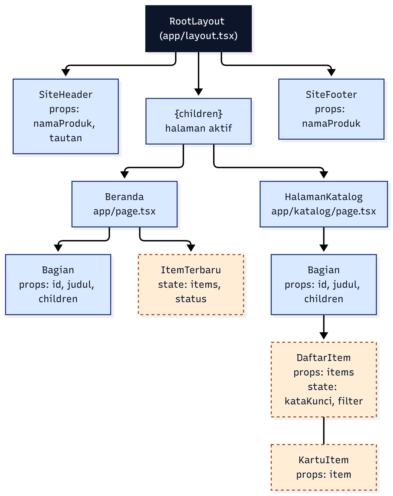
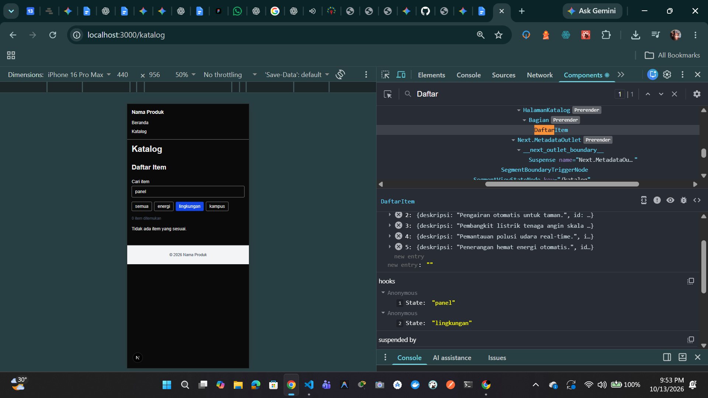
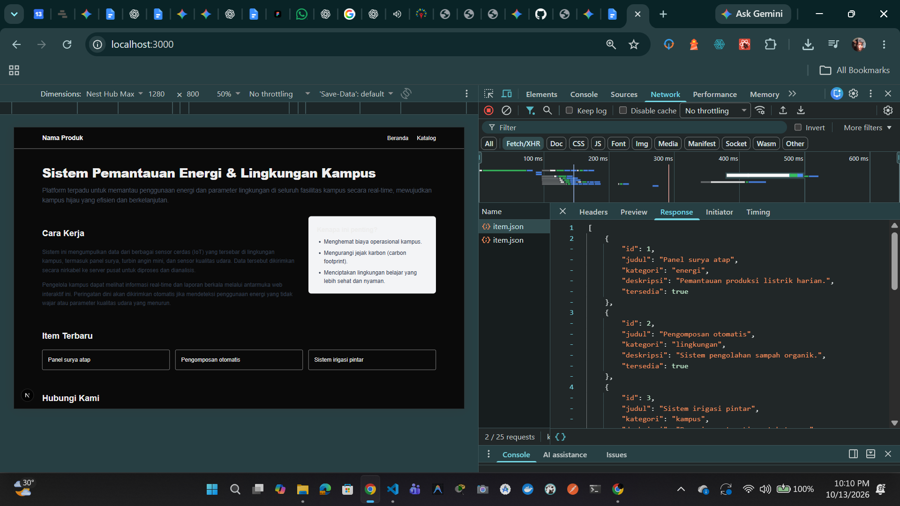
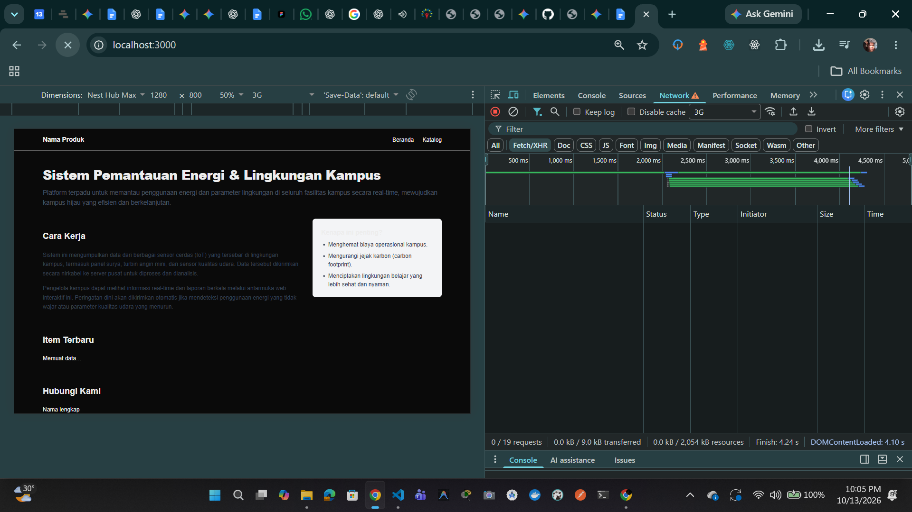
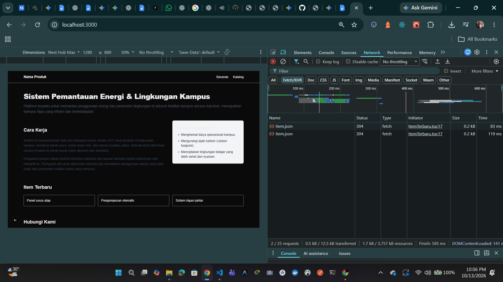
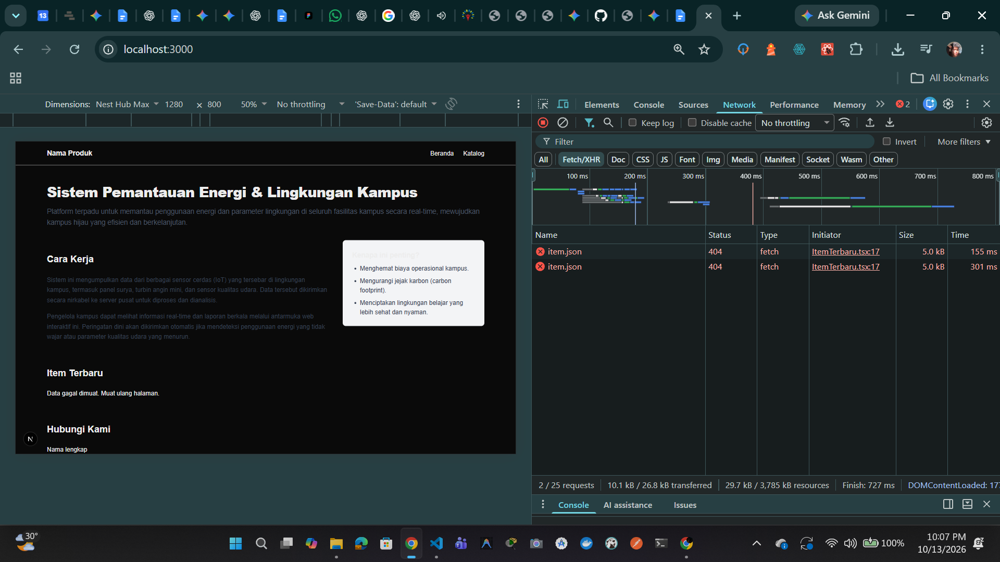
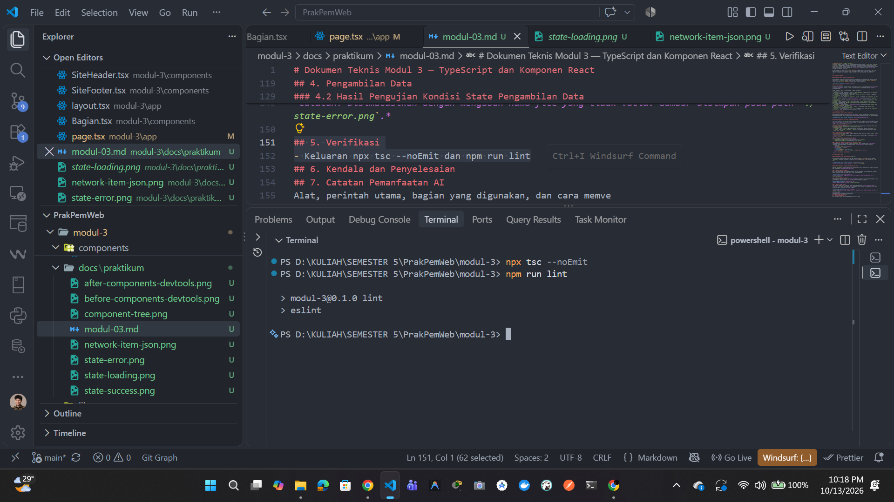

# Dokumen Teknis Modul 3 — TypeScript dan Komponen React
Nama/NIM : Iman Dwi Satrio / 105224029
Repositori : https://github.com/imanseng/105224029_PrakPemWeb

## 1. Tipe Data Produk

### Kode pada `lib/tipe.ts`
```typescript
export type Kategori = "energi" | "lingkungan" | "kampus";

export interface Item {
  id: number;
  judul: string;
  kategori: Kategori;
  deskripsi: string;
  tersedia: boolean;
  gambar?: string;
}

Tentu, ini format Markdown utuh untuk **1. Tipe Data Produk** yang bisa langsung disalin:

```markdown
# Dokumen Teknis Modul 3 — TypeScript dan Komponen React
Nama/NIM : Iman Dwi Satrio / 105224029
Repositori : https://github.com/imanseng/105224029_PrakPemWeb

## 1. Tipe Data Produk

### Kode pada `lib/tipe.ts`
```typescript
export type Kategori = "energi" | "lingkungan" | "kampus";

export interface Item {
  id: number;
  judul: string;
  kategori: Kategori;
  deskripsi: string;
  tersedia: boolean;
  gambar?: string;
}
```
### Alasan Pemilihan Union Type dan Properti Opsional

* **Union Type (`Kategori`)**
* Tipe `Kategori` didefinisikan menggunakan *String Literal Union Type* (`"energi" | "lingkungan" | "kampus"`).
* **Alasan**: Membatasi nilai kategori secara eksplisit untuk menjaga keamanan tipe data (*type safety*). Hal ini memastikan aplikasi hanya menerima nilai kategori yang valid serta mencegah kesalahan penulisan (*typo*) saat pengolahan data maupun pada komponen filter.
* **Properti Opsional (`gambar?: string`)**
* Properti `gambar` diberi tanda `?` yang menandakan nilainya opsional (`string` atau `undefined`).
* **Alasan**: Mengakomodasi kemungkinan adanya data item yang belum atau tidak memiliki berkas gambar/poster. Dengan membuat properti ini opsional, komponen antarmuka (UI) dapat mengantisipasi kondisi tanpa gambar (misalnya menampilkan *placeholder*) tanpa memicu galat *runtime* atau pelanggaran tipe pada TypeScript.

Berikut adalah draf bagian **2. Struktur Komponen** lengkap dalam format Markdown (`.md`) yang dapat langsung disalin ke dokumen teknis Anda. Bagian gambar sudah disediakan dengan klausa/template penyematan *path* gambar, diagram Mermaid, serta tabel komponen yang mendetail.

---

## 2. Struktur Komponen

### 2.1 Diagram Pohon Komponen (Component Tree)

Berikut adalah visualisasi arsitektur dan hierarki hubungan antar komponen pada aplikasi Next.js (App Router) di `modul-3`. Diagram memperlihatkan pemisahan peran antara **Server Component** (latar biru) dan **Client Component** (latar oranye garis putus-putus).



### 2.2 Tabel Komponen

Tabel berikut memetakan seluruh komponen pada folder `modul-3`, jenis komponen (*Server Component* vs *Client Component*), properti (`props`) beserta tipenya, serta tempat komponen tersebut diimplementasikan.

| Nama Komponen | Jenis | Props dan Tipe | Tempat Digunakan |
| --- | --- | --- | --- |
| `RootLayout` | Server Component | `children`: `React.ReactNode` | Didefinisikan di `app/layout.tsx`, menjadi layout utama wrapper seluruh halaman |
| `SiteHeader` | Server Component | `namaProduk`: `string`<br>`tautan`: `Tautan[]` | Digunakan oleh `RootLayout` di `app/layout.tsx` |
| `SiteFooter` | Server Component | `namaProduk`: `string` | Digunakan oleh `RootLayout` di `app/layout.tsx` |
| `Beranda` | Server Component | *Tidak memiliki props* | Halaman utama aplikasi di `app/page.tsx` |
| `HalamanKatalog` | Server Component | *Tidak memiliki props* | Halaman katalog produk di `app/katalog/page.tsx` |
| `Bagian` | Server Component | `id`: `string`<br>`judul`: `string`<br>`children`: `React.ReactNode` | Digunakan oleh `Beranda` (`app/page.tsx`) dan `HalamanKatalog` (`app/katalog/page.tsx`) sebagai kontainer seksi |
| `ItemTerbaru` | Client Component | *Tidak memiliki props* | Digunakan di dalam `Beranda` pada seksi **Item Terbaru** di `app/page.tsx` |
| `DaftarItem` | Client Component | `items`: `Item[]` | Digunakan di dalam `Bagian` pada `HalamanKatalog` di `app/katalog/page.tsx` |
| `KartuItem` | Client Component* | `item`: `Item` | Digunakan oleh `DaftarItem` di `components/DaftarItem.tsx` untuk menampilkan masing-masing kartu produk |

## 3. State dan Interaksi

### 3.1 Tangkapan Layar DevTools Components

Berikut adalah dokumentasi struktur *Props* dan *State* internal pada komponen `DaftarItem` yang diperiksa menggunakan React Developer Tools saat pengguna melakukan pencarian dan penyaringan data:



### 3.2 Penjelasan Alur dari Event hingga Render Ulang

Pada Client Component `DaftarItem`, proses pembaruan antarmuka pengguna (UI) mengacu pada prinsip *unidirectional data flow* di React. Berikut adalah alur eksekusi dari pemicuan *event* pengguna hingga proses render ulang (*re-render*):

#### 1. Inisialisasi State & Props
- **Props (`items`)**: Komponen `DaftarItem` menerima data awal berupa array objek `Item[]` yang dikirim dari halaman `HalamanKatalog` (`app/katalog/page.tsx`).
- **State Internal**:
  - `kataKunci` (tipe: `string`): Menyimpan masukan teks pencarian pengguna (nilai awal: `""`).
  - `filter` (tipe: `string` / `Kategori | "semua"`): Menyimpan pilihan filter kategori aktif (nilai awal: `"semua"`).

#### 2. Pemicuan Event (User Interaction)
- **Event Pencarian**: Saat pengguna mengetik pada kolom input pencarian, elemen `<input>` memicu *event listener* `onChange`.
- **Event Filter Kategori**: Saat pengguna menekan tombol pilihan kategori, elemen memicu *event listener* `onClick`.

#### 3. Pembaruan State (State Mutation via Setter)
- Handler fungsi memanggil fungsi pengubah *state*:
  - `setKataKunci(e.target.value)` untuk memperbarui nilai `kataKunci`.
  - `setFilter(kategoriBaru)` untuk memperbarui nilai `filter`.

#### 4. Kalkulasi Komputasi & Rekonsiliasi (Re-render Trigger)
- Perubahan nilai *state* menandai komponen `DaftarItem` perlu dirender ulang (*re-render*).
- Komponen menjalankan kembali logika penyaringan (*filtering logic*) secara responsif:
  ```typescript
    const hasil = items.filter((item) => {
    const cocokKata = item.judul
      .toLowerCase()
      .includes(kataKunci.toLowerCase());
    const cocokKategori = filter === "semua" || item.kategori === filter;

    return cocokKata && cocokKategori;
  });

## 4. Pengambilan Data

### 4.1 Tangkapan Layar Panel Network (`item.json`)

Berikut adalah dokumentasi aktivitas jaringan pada tab **Network (Fetch/XHR)** saat komponen `ItemTerbaru` melakukan permintaan asynchronous untuk mengambil data produk dari berkas `item.json`:


*Catatan: Berkas gambar disimpan pada path `./network-item-json.png`.*


### 4.2 Hasil Pengujian Kondisi State Pengambilan Data

Komponen `ItemTerbaru` mengimplementasikan manajemen state untuk menangani tiga kondisi penanganan data asynchronous (*data fetching lifecycle*):

#### 1. Kondisi Memuat (Loading)
Saat proses pengambilan data sedang berlangsung di latar belakang, sistem menampilkan indikator memuat data untuk memberikan umpan balik visual kepada pengguna.


*Catatan: Disimulasikan menggunakan Network Throttling (3G). Gambar disimpan pada path `./state-loading.png`.*

#### 2. Kondisi Berhasil (Success)
Setelah permintaan HTTP berhasil (*status code 200 OK*), data JSON diparsing dan disimpan ke dalam state komponen, kemudian daftar item dirender ke dalam antarmuka pengguna.


*Catatan: Gambar disimpan pada path `./state-success.png`.*

#### 3. Kondisi Gagal (Error)
Jika terjadi kegagalan jaringan atau berkas data tidak ditemukan (*status code 404 / network failure*), blok `catch` pada fungsi *fetch* menangkap galat tersebut dan memperbarui state untuk menampilkan pesan kesalahan yang ramah pengguna.


*Catatan: Disimulasikan dengan mengubah nama file yang tidak valid. Gambar disimpan pada path `./state-error.png`.*

## 5. Verifikasi

Untuk memastikan keandalan kode, bebas dari kesalahan tipe data (*type safety*), serta memenuhi standar konvensi penulisan kode (*linting standards*), dilakukan dua tahap pengujian statis melalui terminal:

### 5.1 Tangkapan Layar Terminal Verifikasi

Berikut adalah hasil eksekusi perintah `npx tsc --noEmit` dan `npm run lint` pada terminal proyek:


*Catatan: Berkas gambar disimpan pada path `./verification-terminal.png`.*


### 5.2 Rincian Hasil Pemeriksaan

#### 1. Pemeriksaan Tipe TypeScript (`npx tsc --noEmit`)
Perintah ini berfungsi untuk memvalidasi seluruh tipe data, *interface*, dan *props* pada file `.ts` dan `.tsx` tanpa menghasilkan berkas kompilasi Javascript (*no emit*).
- **Hasil**: Eksekusi berjalan sukses tanpa menemukan kesalahan (*0 errors*).
- **Kesimpulan**: Seluruh *interface* tipe (seperti `Tautan`, `Item`, dan `Kategori`) serta destrukturisasi *props* pada setiap komponen telah terdefinisi secara presisi dan aman secara tipe (*type-safe*).

#### 2. Pemeriksaan Standar Kode (`npm run lint`)
Perintah ini menjalankan skrip ESLint bawaan Next.js untuk mengecek kepatuhan kode terhadap aturan *best practices*, impor yang tidak terpakai, serta sintaksis React/Next.js.
- **Hasil**: `✔ Tidak ada masalah`
- **Kesimpulan**: Seluruh berkas di dalam direktori `app/` dan `components/` telah memenuhi standar kebersihan kode dan bebas dari *warning* maupun *error*.

## 6. Kendala dan Penyelesaian

Dalam proses pengerjaan, pengujian, serta penyusunan dokumen teknis pada Modul 3 ini, terdapat beberapa kendala teknis yang dihadapi beserta langkah penyelesaiannya:

1. **Galat Status HTTP 404 pada Pengambilan Data (`item.json`)**
   - **Kendala**: Saat pengujian *data fetching* pada komponen `ItemTerbaru` di halaman beranda, permintaan HTTP menunjukkan status galat `404 Not Found` pada panel Network DevTools (`http://localhost:3000/data/item.json`).
   - **Penyebab**: Terdapat ketidaksesuaian penamaan berkas antara kode pemanggil (`fetch("/data/item.json")`) dengan nama berkas dummy yang tersimpan di direktori `public/data/` (`dummyItem.json`).
   - **Penyelesaian**: Mengubah nama berkas data JSON pada direktori `public/data/` dari `dummyItem.json` menjadi `item.json` agar selaras dengan skrip *fetch* pada komponen `ItemTerbaru.tsx`.

2. **Deteksi *Unused Import Warning* saat Pemeriksaan Linter (`npm run lint`)**
   - **Kendala**: Saat menjalankan perintah `npm run lint`, terminal memberikan laporan `1 problem (0 errors, 1 warning)` pada berkas `app/page.tsx`.
   - **Penyebab**: Modul `Link` diimpor pada baris pertama di `app/page.tsx` (`import Link from 'next/link'`), namun tidak digunakan di dalam struktur JSX komponen `Beranda`.
   - **Penyelesaian**: Menghapus baris deklarasi *import* `Link` yang tidak terpakai pada `app/page.tsx`, sehingga eksekusi `npm run lint` berikutnya menghasilkan laporan bersih tanpa *warning*.

3. **Sinkronisasi Desain Component Tree dengan Panduan Modul Praktikum**
   - **Kendala**: Pembuatan *Component Tree* awal belum memisahkan komponen berdasarkan jenis arsitektur Next.js App Router secara tepat sesuai konvensi modul.
   - **Penyelesaian**: Memetakan ulang seluruh komponen berdasarkan pemisahan **Server Component** (garis tepi *solid* dengan warna biru) dan **Client Component** (garis tepi *dashed* dengan warna oranye) sesuai dengan deklarasi `"use client"` serta menginisialisasinya ke dalam skrip Mermaid.js.

## 7. Catatan Pemanfaatan AI

Penggunaan asisten AI (Gemini) dimanfaatkan secara terukur sebagai mentor teknis interaktif untuk mempercepat analisis arsitektur kode, pembuatan diagram, serta debugging.

Link Chat: https://share.gemini.google/qTXiBcoMiY16

| Aspek | Rincian |
|---|---|
| **Alat AI yang Digunakan** | Google Gemini (Gemini Flash / CLI Assistant) & Visual Studio Code Assistant |
| **Perintah Utama (Prompts)** | 1. *"Lihat repository tersebut dan buat component tree berdasarkan repository tersebut... buatkan dalam format code snippet mermaid.js saja."*<br>2. *"Buatkan component tree nya dalam format mermaid dan Tabel komponen: nama, props dan tipenya, tempat digunakan (dalam format md biar bisa saya salin)."*<br>3. *"Item.json saya erorr gini kenapa? Apa karena saya buta file nya itu dummyItem.json?"*<br>4. *"Ini aman ga? (Mengecek keluaran terminal tsc --noEmit dan npm run lint)"* |
| **Bagian Kode / Dokumen yang Dibantu** | - Penyusunan struktur *Component Tree* dalam format Mermaid.js.<br>- Pemetaan tabel komponen (*props*, jenis komponen, dan lokasi penggunaan).<br>- Identifikasi dan resolusi galat `404 Not Found` pada jalur pengambilan data JSON.<br>- Analisis *warning* ESLint pada berkas `app/page.tsx` dan langkah pembersihan kode (*refactoring*). |
| **Cara Memverifikasi Hasil AI** | - **Uji Statis**: Menjalankan perintah `npx tsc --noEmit` dan `npm run lint` langsung di terminal lokal untuk memastikan tidak ada galat sintaksis maupun tipe data.<br>- **Uji Dinamis**: Menguji fungsionalitas aplikasi di peramban (`http://localhost:3000`), mengecek perubahan *state* pada tab **React DevTools Components**, serta memverifikasi status *request* `200 OK` di tab **Network**. |